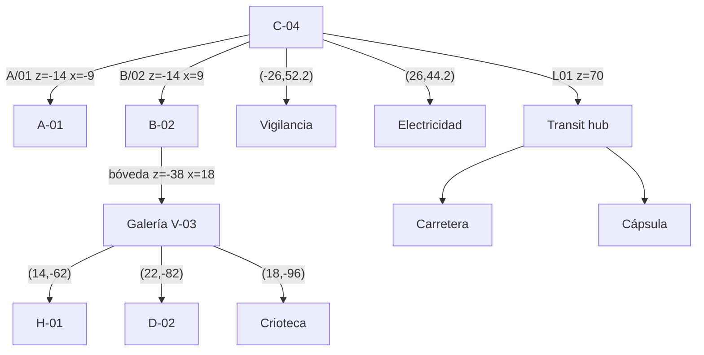

# Laboratorio modular por zonas

División derivada de `Sectors.zone()`, `ZoneGates`, `PortalLight` y la geometría fuente.

Estado (fase 13): las doce zonas están registradas, enlazadas y con streaming real. Las escenas indicadas en la columna «ID / escena» ya existen; los nombres de C-04 y A-01 se mantienen en `zone_c04_shell.tscn` y `zone_a01_shell.tscn`. El contenido interactivo específico de cada módulo sigue pendiente.

| ID / escena | Límite | Contenido exclusivo |
|---|---|---|
| `c04/zone_c04_containment.tscn` | `z>-14`, núcleo | campo de 24 lados, W-01 cuando corresponda, luces |
| `a01/zone_a01_archive.tscn` | `-38<z<-14`, `x<0` | archivos, gavetas, folios y banco |
| `b02/zone_b02_turbines.tscn` | `-38<z<-14`, `x>=0` | turbinas, lector V-03, diagnóstico/rearme |
| `surveillance/zone_surveillance.tscn` | `x<-17.3`, `z>52.2` | matriz de seis monitores y controles |
| `electrical/zone_electrical.tscn` | `x>17.3`, `z>44.2` | 12 alimentadores, medidores y 4 extractores |
| `v03_gallery/zone_v03_gallery.tscn` | `-96<z<-38`, `14<=x<=22` | corredor axial y conexiones |
| `h01/zone_h01_hydraulics.tscn` | `-96<z<-38`, `x<14` | tres vasos, larvas y purga |
| `d02/zone_d02_records.tscn` | `-96<z<-38`, `x>22` | archivo óptico e incidencias |
| `v03_cryo/zone_v03_cryotheque.tscn` | `z<-96` | custodia, módulos, analizador y muestra |
| `transit_hub/zone_transit_hub.tscn` | umbral `z=70` | L01, andén y transferencia |
| `transit_road/zone_transit_road.tscn` | `z>70`, `x<=6.1` | carretera 2000 m y muro terminal |
| `transit_rail/zone_transit_rail.tscn` | `z>70`, `x>6.1` | vía, andenes, cápsula y asientos |

Transit puede agruparse durante el primer puerto de fidelidad, pero mantendrá subescenas descargables para Android. En la implementación actual `transit_hub`, `transit_road` y `transit_rail` son módulos separados: el hub es la sala de andén (z 70–96) y las dos vías miden 2000 m con luces cada 120 m.

La fuente de verdad ejecutable es `data/zone_graph.json`, generada junto con manifiestos, GLB y escenas por `tools/generate_zone_modules.py`.

## Conexiones comprobadas

Cada zona contiene `ZoneRoot`, visuales, StaticBody3D, luces/audio local, InteractionRegistry y DoorSockets. Nunca Player, cámara global, GameState o ZoneManager.